# terminal-to-svg

Convert live terminal sessions, ANSI outputs, commands, and tmux panes into beautiful, vector-crisp SVGs matching modern dark TUI aesthetics.

Powered by the **[`github.com/smford/golang-term2svg`](https://github.com/smford/golang-term2svg)** core Go module.

---

## Visual Gallery of Examples

Here are screenshots generated directly by `termtosvg`, showcasing key features and themes:

### 1. Multi-Tab Navigation & Header Badge
Replicates full monitoring console windows with macOS-style window controls, clickable top tabs, and status badges.


```bash
printf "\033[38;5;242m14:03:00.012\033[0m \033[1;32m[INFO ]\033[0m Starting ONVIF Camera Simulator\n" \
  | termtosvg -o examples/00-tabs-nav.svg \
      -title "onvif-camera-simulator — [3] Event Log (Ring Buffer)" \
      -tabs "[1] Dashboard,[2] Configuration,[3] Event Log" \
      -active-tab 2 \
      -header "System Event Log (Ring Buffer - Last 250 Records)" \
      -badge "FOLLOW: AUTO-SCROLL (ON)" \
      -cursor
```

---

### 2. Auto-Crop & Interactive Monospace Cursor
Automatically analyzes non-empty cells and shrinks the canvas tightly around actual visible output.


```bash
git status | termtosvg -o examples/01-autocrop.svg -title "git status" -auto-crop -cursor
```

---

### 3. CI/CD Pipeline Automation
Capture build logs, automated test runs, and verification steps in CI/CD pipelines (e.g. GitHub Actions, GitLab CI).


```bash
# In your GitHub Actions or Makefile workflow:
make test 2>&1 | termtosvg -o docs/ci-status.svg \
  -title "GitHub Actions — CI/CD Pipeline #4821" \
  -header "Pipeline Job: Build & Test Matrix" \
  -badge "STATUS: PASSED" \
  -auto-crop
```

---

### 4. Box-Drawing Grid Alignment & Themes (Catppuccin)
Isolates Unicode box-drawing characters (`U+2500`–`U+257F`) and calculates explicit `x` coordinates to guarantee pixel-perfect vertical alignment across all browsers and font engines.


```bash
kubectl get pods | termtosvg -o examples/03-theme-catppuccin.svg \
  -theme catppuccin \
  -title "Kubernetes Cluster — us-east-1" \
  -tabs "Workloads,Pods,Ingresses,ConfigMaps" \
  -active-tab 1 \
  -auto-crop
```

---

### 5. SRE SLO & Latency Matrix (Nord Theme)
Arctic slate theme featuring nested headers, subheaders, and error budget statuses.


```bash
termtosvg -theme nord -auto-crop \
  -title "SRE Production Dashboard (Nord)" \
  -tabs "Global Matrix,EU Region,US Region" \
  -active-tab 1 \
  -header "SLO / Error Budget Burn Rate (Last 24h)" \
  -badge "SRE ON-CALL: ACTIVE"
```

---

### 6. Light Theme for Documentation & Print
Clean white/gray palette for light-mode documentation, READMEs, and technical whitepapers.


```bash
curl -i https://api.internal/metrics | termtosvg -o examples/02-theme-light.svg \
  -theme light \
  -title "OpenTelemetry Collector — Service Logs" \
  -header "Telemetry Exporter Daemon (OTel / Prometheus)" \
  -badge "STATE: HEALTHY" \
  -auto-crop
```

---

### 7. Frameless Card for Markdown & Documentation Embedding
Minimalist rounded card with no macOS window header bar, ideal for clean inline embedding in GitHub READMEs.


```bash
curl -i https://status.internal/healthz | termtosvg -o examples/05-theme-frameless.svg \
  -theme frameless \
  -auto-crop
```

---

### 8. Security Redaction Engine (`-mask-secrets`)
Automatically sanitizes IP addresses, Bearer tokens, passwords, API keys, and JWTs before generating images.


```bash
cat incident-audit.log | termtosvg -o examples/07-redaction.svg \
  -title "Security Redaction Demo" \
  -header "Sanitized Audit Log" \
  -badge "SANITIZED: TRUE" \
  -mask-secrets \
  -auto-crop
```

---

### 9. Interactive Hyperlinks (OSC 8)
Converts terminal OSC 8 hyperlink sequences into real, clickable SVG `<a href="...">` links.


```bash
printf "Docs: \033]8;;https://golang.org\033\\\\Go Website\033]8;;\033\\\\\n" \
  | termtosvg -o examples/08-hyperlinks.svg -auto-crop
```

---

### 10. ANSI Background Colors & Highlights
Renders `<rect>` background fills under colored text spans for selection blocks, high-contrast statuses, and progress bars.


```bash
printf "  \033[44;37m[1] Auth Service     CPU: 12%%  STATUS: RUNNING  \033[0m\n" \
  | termtosvg -o examples/09-background-fills.svg -auto-crop
```

---

### 11. Live Terminal Capture (Colorized Heuristic)
Running `termtosvg` bare without arguments snapshots what is currently on your terminal screen and colorizes log levels, timestamps, and key-value pairs.


```bash
termtosvg -o examples/11-live-terminal.svg -auto-crop -title "Live Terminal Snapshot"
```

---

## Pipeline & Automation Integration

Because `termtosvg` reads from `stdin` and writes to `stdout` (`-o -`), it integrates into Unix pipelines and CI/CD jobs.

### Example: Unix Pipeline with Filtering & Compression
```bash
# Filter errors from Kubernetes logs, mask secrets, and stream directly into a compressed SVG
kubectl logs deployment/api --tail=100 \
  | grep -E "ERROR|WARN" \
  | termtosvg -o - -mask-secrets -title "API Errors" -auto-crop \
  | gzip > api-errors.svg.gz
```

### Example: GitHub Actions CI Workflow
Add this step to your GitHub Actions workflow to generate an SVG artifact of test results:

```yaml
name: Test & Generate Visual Artifact
on: [push, pull_request]

jobs:
  build:
    runs-on: ubuntu-latest
    steps:
      - uses: actions/checkout@v4

      - name: Set up Go
        uses: actions/setup-go@v5
        with:
          go-version: '1.24'

      - name: Install termtosvg
        run: go install github.com/smford/terminal-to-svg/cmd/termtosvg@latest

      - name: Run Tests & Capture Visual SVG
        run: |
          go test -v ./... 2>&1 | termtosvg \
            -o docs/test-report.svg \
            -title "Go Test Suite — GitHub Actions" \
            -header "Automated Test Matrix" \
            -badge "CI: PASSING" \
            -auto-crop

      - name: Upload Test Report SVG
        uses: actions/upload-artifact@v4
        with:
          name: test-report-svg
          path: docs/test-report.svg
```

---

## Installation & Build

```bash
git clone git@github.com:smford/terminal-to-svg.git
cd terminal-to-svg
make build
```

---

## Go Module Usage (`github.com/smford/golang-term2svg`)

For Go programs and microservices needing programatic SVG generation without invoking external processes:

```go
package main

import (
    "context"
    "os"
    "github.com/smford/golang-term2svg"
)

func main() {
    svg, err := term2svg.CommandToSVG(context.Background(), "git", []string{"status"}, term2svg.Options{
        Title:       "Git Working Tree",
        Theme:       "dark",
        AutoCrop:    true,
        ShowCursor:  true,
        MaskSecrets: true,
    })
    if err != nil {
        panic(err)
    }

    _ = os.WriteFile("status.svg", []byte(svg), 0644)
}
```